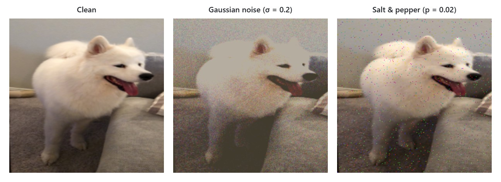
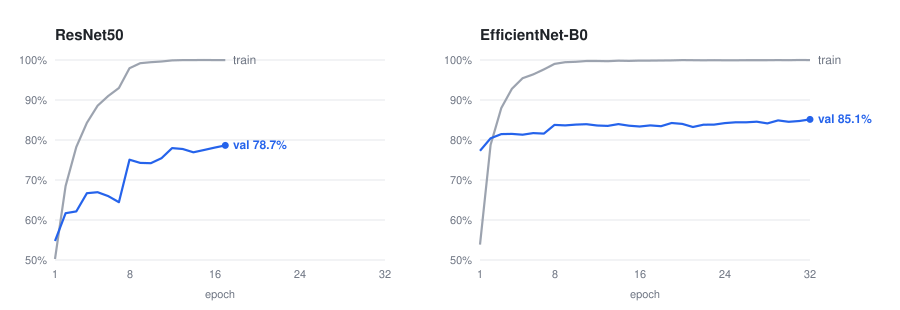
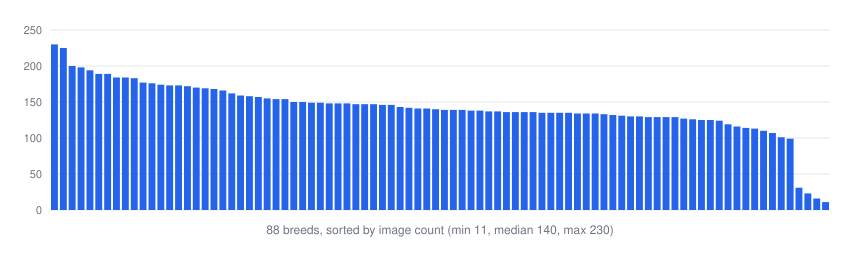

# Robustness of CNNs for Fine-Grained Dog Breed Classification

How much do pretrained CNNs degrade when the input image gets noisy? We fine-tune **ResNet50** and **EfficientNet-B0** on an 88-breed dog dataset, then measure how each model holds up under **Gaussian** and **salt-and-pepper** noise.

Final project for **CS 4452 (Western University, Winter 2026)** · [Full report (PDF)](final%20report.pdf) · [Notebook](ModelTraining.ipynb)




## Highlights

- **End-to-end pipeline** in one notebook: data cleaning → training → evaluation → robustness analysis.
- **Automated data cleaning** with multi-threaded perceptual hashing (pHash): removed 45 duplicate images and 22 images that appeared under conflicting breed labels.
- **Two transfer-learning models** compared under an identical setup: ResNet50 (~23.7M parameters) vs EfficientNet-B0 (~4.1M parameters).
- **Robustness evaluation** through a dataset wrapper that injects noise on the fly, so both models are scored on exactly the same corrupted images.

## Results

### Clean images (held-out validation set)

| Model | Parameters | Best validation accuracy | Epochs (early stopping) |
|---|---|---|---|
| ResNet50 | 23.7M | 78.7% | 17 |
| **EfficientNet-B0** | **4.1M** | **85.1%** | 32 |

EfficientNet-B0 is more accurate with under a fifth of the parameters. Both models reach ~100% training accuracy, so the remaining gap is overfitting on a small dataset (about 110 training images per breed).



### Under noise

Change in accuracy relative to each model's clean score on the same evaluation split:

| Noise | ResNet50 | EfficientNet-B0 |
|---|---|---|
| Gaussian (σ = 0.2, every pixel) | −39.3 pts | −38.0 pts |
| Salt & pepper (2% of values) | −13.4 pts | **−1.3 pts** |

- Dense Gaussian noise breaks both models to a similar degree.
- Sparse impulse noise barely affects EfficientNet-B0 but costs ResNet50 over 13 points.

> **How to read these numbers.** The noise comparison in the notebook was run after reloading the saved checkpoints, and the train/validation split was not seeded, so that evaluation split overlaps the original training images. The absolute accuracies printed there (96–97% clean) are therefore optimistic; the held-out figures are the ones in the first table. The relative drops above are still a fair like-for-like comparison between the two models. See [Limitations](#limitations-and-next-steps).

## Method

**Dataset.** [Dog Breeds Image Dataset](https://www.kaggle.com/datasets/darshanthakare/dog-breeds-image-dataset) (Kaggle). Breeds with fewer than 10 images are dropped (94 → 88 classes), leaving 12,487 images; cleaning brings this to 12,420, split 80/20 into 9,936 training and 2,484 validation images.



**Cleaning.**
1. Integrity check: open and verify every file, discard corrupted or tiny images.
2. pHash every image; identical hashes within a breed are duplicates (keep one).
3. Identical hashes across *different* breeds are label conflicts (drop the whole group).

**Training.**

| Setting | Value |
|---|---|
| Initialisation | ImageNet-pretrained weights, new classification head, all layers fine-tuned |
| Input | 224 × 224, ImageNet normalisation, no augmentation |
| Optimiser | AdamW, learning rate 3e-4, weight decay 1e-4 |
| Loss | Class-weighted cross-entropy with label smoothing 0.05 |
| Schedule | ReduceLROnPlateau (factor 0.5, patience 2), gradient clipping at 1.0 |
| Stopping | Up to 50 epochs, early stopping with patience 4 |
| Batch size | 32 |

**Noise.** Applied to the normalised tensor at evaluation time only (the models never see noise during training):

- Gaussian: add N(0, 0.2²) to every value, then clamp to [−1, 1]
- Salt & pepper: set 1% of values to +1 and 1% to −1

Metrics: top-1 and top-3 accuracy, per-class precision / recall / F1, confusion matrices.

## Run it

```bash
git clone https://github.com/Noobtatic/dog-breed-cnn-robustness.git
cd dog-breed-cnn-robustness
pip install -r requirements.txt
```

1. Download the [dataset](https://www.kaggle.com/datasets/darshanthakare/dog-breeds-image-dataset) and unzip it so the breed folders sit in `archive/DogBreedsImageDataset/`.
2. Open `ModelTraining.ipynb` and run all cells.

If `best_resnet50.pth` and `best_efficientnet_b0.pth` are present, the notebook loads them and skips training. Delete them to retrain from scratch (a GPU is strongly recommended).

## Repository layout

```
├── ModelTraining.ipynb        # full pipeline: cleaning, training, evaluation, noise analysis
├── final report.pdf           # 6-page write-up (IEEE format)
├── best_resnet50.pth          # trained weights + training history
├── best_efficientnet_b0.pth
├── assets/                    # figures used in this README
└── requirements.txt
```

## Limitations and next steps

- **Seed the split.** `random_split` runs without a fixed generator, so reloading a checkpoint evaluates on a different split from the one it was trained with. Fixing the seed and retraining would give clean held-out numbers for the noise experiments too.
- **Noise strength is not matched.** Gaussian noise touches every pixel while salt-and-pepper touches 2%, so the gap between noise types reflects intensity as much as noise type.
- **Clamping removes contrast.** ImageNet-normalised values span roughly [−2.1, 2.6], so the clamp to [−1, 1] in the Gaussian path also flattens bright and dark regions (visible in the example image above). Part of the Gaussian drop comes from this, not from the noise itself.
- **Next:** noise augmentation during training, a denoising step before classification, sweeping noise levels, repeated runs with multiple seeds.

## Team

Group project by **Junjie Mo, Zibo Cheng, Zhinan Chen and Haoxuan Suo** (Department of Computer Science, Western University). Original repository: [ZiboCheng/CS4452-Final-Project](https://github.com/ZiboCheng/CS4452-Final-Project).

**My contribution (Haoxuan Suo):** the noise-robustness evaluation, comprising the `NoisyDataset` wrapper and noisy validation loaders, the clean vs Gaussian vs salt-and-pepper comparison for both models, and the per-class reports and confusion matrices under noise.

## References

- He et al., *Deep Residual Learning for Image Recognition*, CVPR 2016
- Tan & Le, *EfficientNet: Rethinking Model Scaling for Convolutional Neural Networks*, ICML 2019
- Hendrycks & Dietterich, *Benchmarking Neural Network Robustness to Common Corruptions and Perturbations*, ICLR 2019
- Zauner, *Implementation and Benchmarking of Perceptual Image Hash Functions*, 2010
